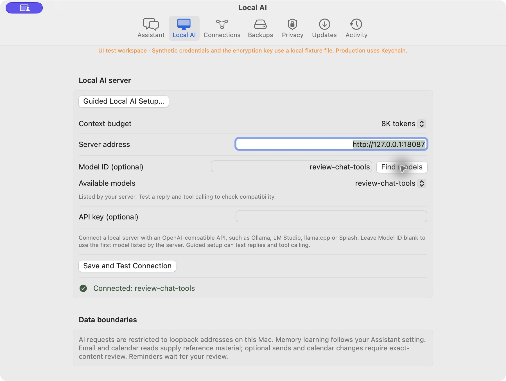
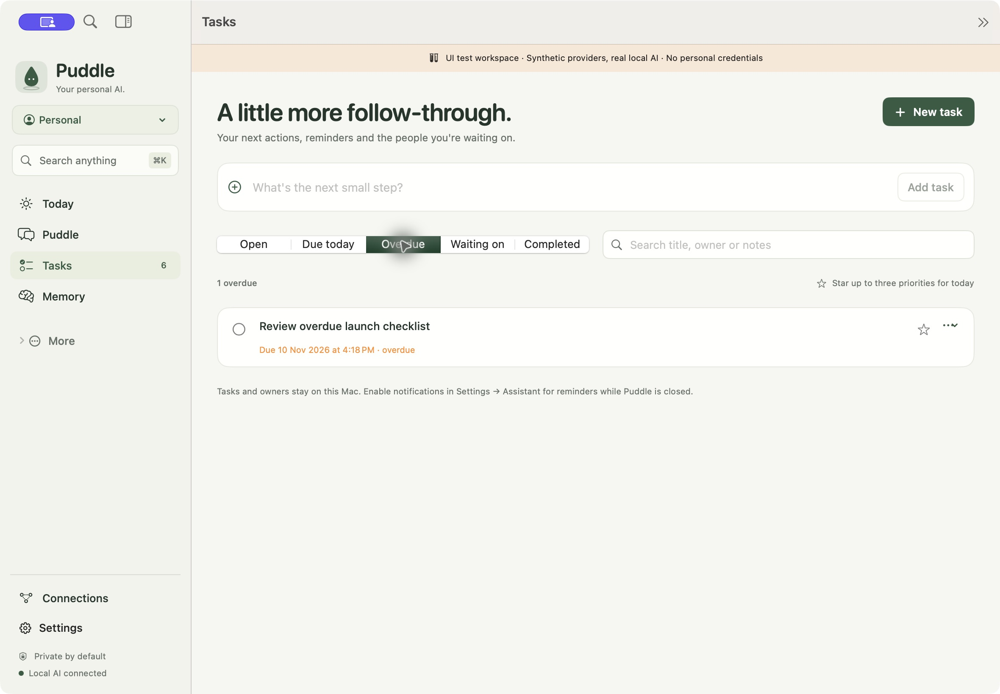
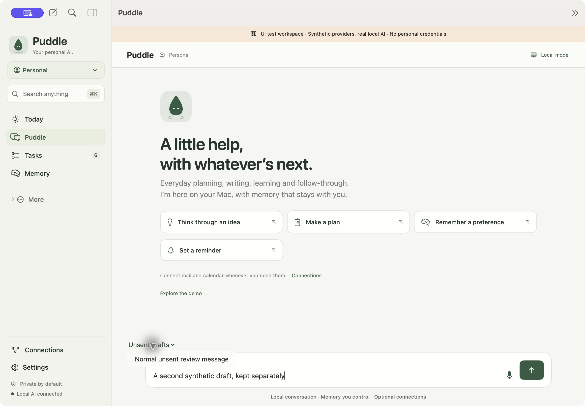
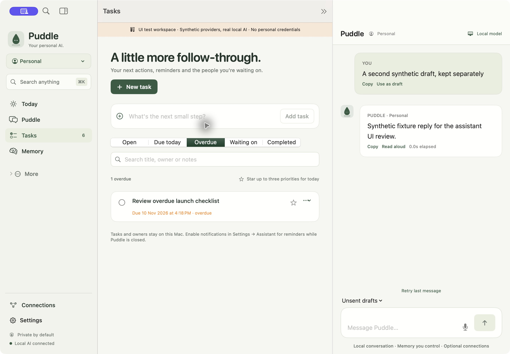

# Local AI and personal assistant product review

Puddle already supports the main personal assistant workflows: local streaming
chat, controlled memory, commitments, a daily brief, optional mail/calendar,
meeting notes, local knowledge, routines and reviewed actions. The most useful
improvements in this pass remove friction from connecting a model, finding the
work behind a daily summary, and keeping an unfinished request.

This review uses `c2ae0bd` as its baseline. It covers the native app's inference,
Today, tasks, conversation, navigation, privacy and settings paths, plus the
documented release gates. It is a product and workflow review, not a repository
security audit or live-provider certification.

## Findings and changes

| Perspective | Gap in the baseline | Result |
| --- | --- | --- |
| Local AI | Setup requires an exact model ID but offers no way to list the server's IDs. Users must copy an ID from another app or accept whichever model is first. | **Find models** and **Available models** work in guided setup and Settings. Discovery only reads `/v1/models`, preserves server order and manual selection, removes duplicate/blank IDs, and handles empty/offline servers. Address/key edits and cancellation invalidate late results. Reply/tool compatibility remains a separate test. |
| Personal assistant | Today's overdue/waiting counters and commitment links open the complete task list. There is no deadline filter to recover the group the user just selected. | **Due today** and **Overdue** join Open, Waiting on and Completed. Today opens the corresponding filter. Due today means remaining deadlines in the current local day; overdue contains earlier deadlines. The view updates every minute. Capturing an undated task returns to Open so the result is visible. |
| UX | The composer belongs to a temporary SwiftUI view. Navigating to Tasks can discard an unfinished message; the main chat and assistant panel can hold different drafts. Sending can also erase newer text typed while the initial save waits. | Drafts belong to their conversation in the shared store. They follow navigation and the panel; **Unsent drafts** reopens another draft, even before its first message. Submission clears only the submitted revision after a successful save. Quit offers to keep the app open for unsent messages. |
| UI | Task controls do not express deadline focus; model setup exposes only a manual text field. Recovery states need to explain the next step. | Native named selectors expose the new choices. Task search stacks below filters at panel width; new filters have specific empty states. Model loading has progress/cancel, empty guidance and a readable error. Existing styling and navigation stay consistent. |

Drafts stay in memory until sent and are excluded from snapshots and portable
backups. Private and demo sessions use separate drafts and restore normal drafts
on exit. Deleting a conversation removes its draft after the deletion saves.
No workspace schema, provider permission or dependency changes are required.
An unexpected process exit still loses unsent drafts; durable draft recovery
would need a separate retention and encryption design.

## Further priorities

| Priority | Remaining gap or decision | Next step |
| --- | --- | --- |
| P1 | The supported model/runtime matrix and lower-resource performance are not established by listing models or fixture replies. | Finish [live model acceptance #90](https://github.com/linson007/puddle/issues/90) and [hardware budgets #94](https://github.com/linson007/puddle/issues/94). Record exact models/runtimes, cold-start latency, cancellation and tool quality. |
| P1 | Real first-run, VoiceOver, keyboard and supported-OS acceptance remain open. | Complete [accessibility and first-run acceptance #93](https://github.com/linson007/puddle/issues/93), including the new selectors, menu and quit recovery. An accessible tree alone does not establish spoken VoiceOver behavior. |
| P1 | Provider actions, recovery and distribution still have external acceptance gates. | Continue [readiness tracker #85](https://github.com/linson007/puddle/issues/85). This change does not close account, signed-distribution, hardware or power-loss gates. |
| P2 | A server may pass the reply probe and fail tool calling. The app reports that distinction, but ordinary conversation still advertises assistant tools. | Decide whether to add an explicit chat-only mode, suppress tool-based learning/actions in that mode, and label unavailable workflows. The current supported assistant contract still requires a tool-capable model. |
| P2 | Assistant replies render with `Text(verbatim:)`, leaving Markdown and code fences as literal text. | Add a safe native response renderer and code-copy controls, retaining the original text for Copy and handling partial streams and long code blocks. |
| P2 | Some global search results navigate only to a workspace: events, memories, routines and errands do not select the matched record. | Add selection state and scrolling for those destinations; retain cache scope and source/freshness explanations. |

Routines after Quit, general desktop control, browser click/type automation,
cross-device sync and OCR are documented scope limits. They are separate product
expansions, not prerequisites for the three improvements implemented here.

## Verification

Automated checks use injected transports and synthetic workspaces. New cases
cover model-list ordering/exact IDs, duplicate and blank IDs, stale discovery,
deadline boundaries in multiple timezones and across a daylight-saving change,
Today/search navigation, navigation-only drafts, failed saves, typing during a
blocked save, private/demo separation, redundant demo transitions and Quit.

| Check | Result |
| --- | --- |
| `make verify` | Localization/concurrency guards and 36 Python tests passed. Swift: 624 discovered, 598 passed, 26 expected opt-in skips, zero failures. |
| `sh scripts/swift.sh test -c release` | 620 discovered, 594 passed, 26 expected opt-in skips, zero failures. |
| `make build` and `python3 scripts/verify-bundle.py` | Release build, signature/resources and refusal of debug fixture launches passed. |
| `git diff --check` | Clean. |

Native observations used macOS 26.6 (25G72), Xcode 27.2 and a separately identified,
ad hoc signed debug app with a disposable workspace. A loopback HTTP fixture at
port 18087 listed three synthetic models and returned synthetic streaming replies
and setup tool calls. **These were fixture responses, not real model inference**;
the generic UI-test banner's “real local AI” text does not describe this server.
No personal workspace, Keychain credentials, connected accounts or live provider
writes were used. The temporary server and review app were stopped afterward.

| Native flow | Observation |
| --- | --- |
| Today and task filters | Overdue and Waiting on counters selected the matching segment and correct synthetic task. Due today selected the future deadline. Capturing from Waiting on returned to Open with the new task visible. |
| Navigation and panel | The same unsent message returned after Tasks → Puddle and appeared in the assistant panel. Filters/search remained readable at panel width. |
| Another draft | New Conversation showed Unsent drafts; choosing the original restored its text and conversation. A second draft stayed separate. |
| Private session | Normal text was absent on entry. Private-only unsent text was absent after exit, and the original normal draft returned. |
| Quit and send | Quit displayed the unsent-message warning. Keep Puddle open retained the draft. Sending each synthetic draft cleared only its composer and produced one corresponding user message/reply. |
| Guided setup | Find models listed all fixture IDs. Choosing the second populated its exact ID; reply/tool verification and saving used that ID. Changing the address removed the list and verification. An offline address showed recovery text; an empty list explained loading a model and retrying. |
| Settings | The saved model appeared in Local AI. Find models exposed the same selector within the grouped form. |

### Synthetic screenshots

